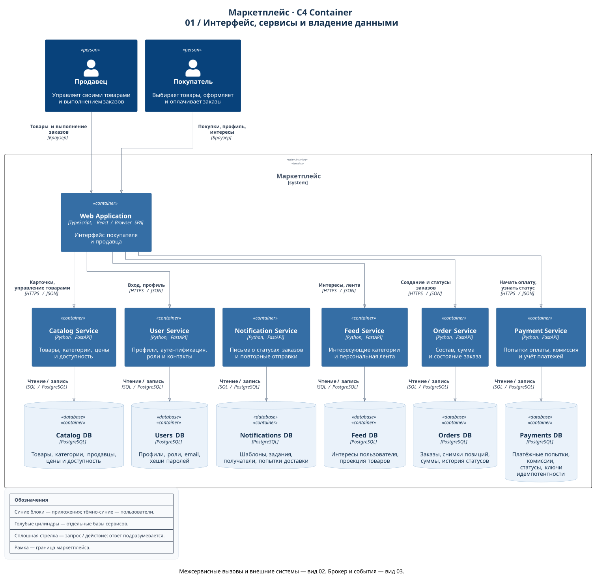
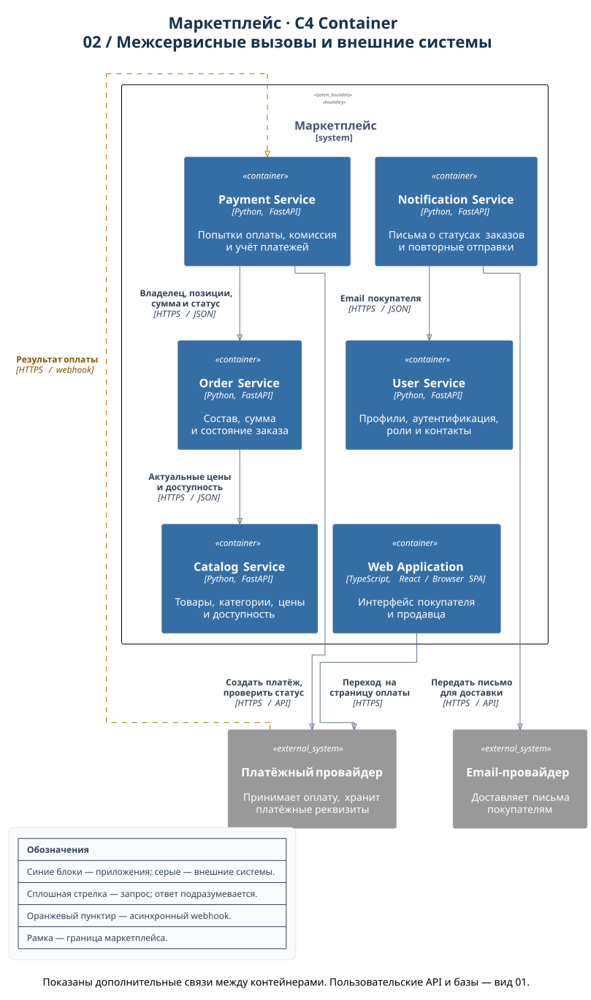
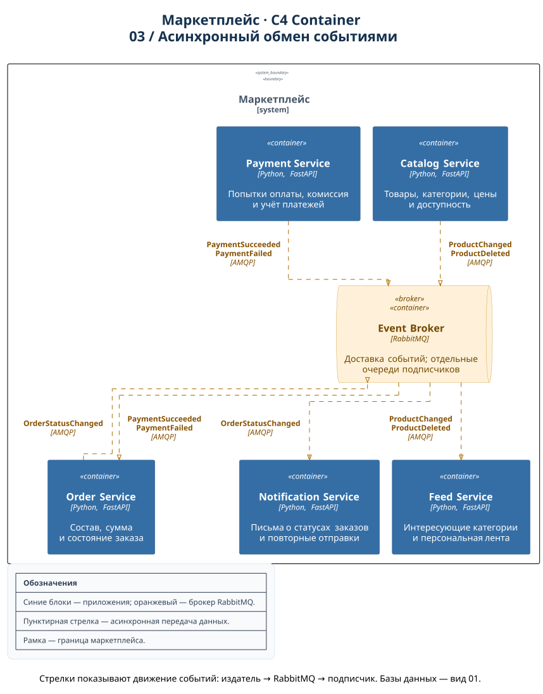

# Архитектура маркетплейса

Проект по домашнему заданию «Архитектурное проектирование системы маркетплейса».
Выполнены пункты 1–3: спроектирована архитектура, подготовлена C4 Container-диаграмма и добавлен минимальный Catalog Service для запуска в Docker. Все остальные приложения и взаимодействия ниже описывают целевую систему. Бизнес-логика не реализуется по условию задания.

## 1. Требования и границы системы

Маркетплейс позволяет продавцам публиковать товары, а покупателям получать персональную ленту, оформлять и оплачивать заказы. Система управляет пользователями, учитывает платежи и отправляет уведомления об изменении статуса заказа.

Участники:

- **Покупатель** — управляет профилем, выбирает интересующие категории, просматривает товары, оформляет и оплачивает заказы.
- **Продавец** — управляет профилем и своими товарами, просматривает относящиеся к нему позиции заказов и отмечает их выполнение.
- **Платёжный провайдер** — внешняя система, которая принимает оплату и сообщает результат.
- **Email-провайдер** — внешняя система доставки писем.

Допущения для учебного проекта:

- Один пользователь может иметь роли покупателя и продавца одновременно.
- Персонализация основана на категориях, которые покупатель выбирает явно. Обучение ML-моделей не требуется.
- Заказ может содержать товары нескольких продавцов; принадлежность каждой позиции продавцу сохраняется в заказе.
- Используется одна валюта — рубль; денежные суммы хранятся целым числом копеек.
- В каталоге есть признак доступности товара. Количественный складской учёт, резервирование остатков, доставка, возвраты, промокоды и реальные выплаты продавцам находятся за рамками этого проекта.
- Уведомления отправляются по email. Платёжные реквизиты вводятся на стороне платёжного провайдера.

## 2. C4 Container-диаграмма

Архитектура показана тремя согласованными видами **одной C4 Container-модели**. Такое разделение позволяет читать подписи без наложений и пересекающихся связей. Одинаковые имена во всех видах обозначают те же контейнеры; каждый вид показывает свою группу взаимодействий. Вместе они содержат все 18 элементов и 26 связей архитектуры.

### 01. Интерфейс, сервисы и владение данными

Пользователи, веб-приложение, шесть сервисов и их отдельные базы данных. Базы расположены под сервисами-владельцами. Notification Service получает задания через брокер на виде 03; прямого вызова из веб-приложения к нему нет.



[Открыть вид 01 в полном размере](docs/c4-container.svg)

### 02. Межсервисные вызовы и внешние системы

Проверка данных перед заказом и оплатой, получение email, взаимодействие с платёжным и почтовым провайдерами. Пунктиром выделен асинхронный платёжный callback. Пользовательские API и базы данных показаны на виде 01.



[Открыть вид 02 в полном размере](docs/c4-calls.svg)

### 03. Асинхронный обмен событиями

Издатели событий, RabbitMQ и подписчики. Order Service получает результат оплаты и публикует изменения статуса заказа; направления этих двух связей показаны отдельно.



[Открыть вид 03 в полном размере](docs/c4-events.svg) · [Исходник всех трёх видов](docs/c4-container.puml) · [Общие определения контейнеров и стили](docs/c4-model.iuml)

У контейнеров указаны технологии и ответственность; у связей — назначение и протокол. Внешние системы находятся за границей маркетплейса, поэтому связи с ними пересекают рамку.

В терминологии [C4 Container](https://c4model.com/diagrams/container) контейнер — приложение или хранилище данных. Это уровень логической архитектуры; он не означает, что уже создан Docker-контейнер.

Легенда размещена на каждом изображении:

- тёмно-синий — пользователь; синий — приложение; голубой цилиндр — отдельная база данных;
- оранжевый — брокер сообщений; серый — внешняя система;
- сплошная стрелка — синхронный запрос или действие пользователя; пунктирная — асинхронное сообщение;
- для синхронных вызовов стрелка направлена от вызывающего к вызываемому, ответ подразумевается;
- для событий стрелка показывает направление доставки данных: издатель → брокер → подписчик;
- рамка обозначает границу маркетплейса.

## 3. Домены, сервисы и владение данными

Выбран вариант с шестью сервисами по бизнес-доменам. Каждый сервис является единственным владельцем своей базы PostgreSQL: другие сервисы обращаются к нему через API или получают его события.

| Домен / сервис | Ответственность | Собственные данные |
| --- | --- | --- |
| **Пользователи — User Service** | Регистрация, аутентификация, профили покупателей и продавцов, роли | **Users DB:** пользователи, хеши паролей, роли, email, профили продавцов |
| **Каталог — Catalog Service** | Создание, изменение и снятие с публикации товаров; проверка принадлежности товара продавцу; актуальные цены и доступность | **Catalog DB:** карточки товаров, категории, `seller_id`, цены, признак доступности, версии карточек |
| **Персональная лента — Feed Service** | Хранение интересующих пользователя категорий и ранжирование товаров | **Feed DB:** выбранные категории пользователя и локальная проекция опубликованных товаров для чтения |
| **Заказы — Order Service** | Оформление заказа, фиксация состава и суммы, состояние заказа и выполнение позиций продавцами | **Orders DB:** заказы, `buyer_id`, позиции со снимками названий, цен и `seller_id`, итоговая сумма, статусы и их история |
| **Платежи — Payment Service** | Создание попыток оплаты, расчёт комиссии и сумм к учёту по продавцам, интеграция с провайдером, учёт результата оплаты | **Payments DB:** попытки оплаты, `order_id`, сумма и валюта, комиссия и суммы по продавцам, идентификаторы провайдера, статусы, ключи идемпотентности |
| **Уведомления — Notification Service** | Формирование писем о статусе заказа, отправка и повторные попытки | **Notifications DB:** задания на отправку, адрес получателя на момент отправки, шаблоны, статусы доставки, число попыток, обработанные события |

**Web Application** — единый интерфейс покупателя и продавца (TypeScript + React, приложение в браузере). Вызывает публичные API сервисов по HTTPS/JSON. Не владеет бизнес-данными и не рассчитывает доверенную сумму заказа или оплаты.

**RabbitMQ** — транспорт событий между сервисами. Хранит сообщения до обработки, но не является источником истины о товарах, заказах или платежах.

Для сервисов выбран **Python + FastAPI**, для каждого хранилища — **PostgreSQL**. Единый стек уменьшает количество технологий в учебном проекте; реляционная модель подходит для пользователей, товаров, заказов и платежей. Сейчас реализован только каркас Catalog Service с `/health`: он не подключается к базе и не содержит бизнес-логики. Остальные сервисы и хранилища показаны как целевая архитектура.

### Правила владения данными

- У каждого сервиса отдельная база и отдельные учётные данные. Прямой доступ к чужой базе, общие таблицы и межсервисные SQL JOIN запрещены.
- Ссылки между доменами представлены идентификаторами: `user_id`, `product_id`, `order_id`. Внешних ключей между базами разных сервисов нет.
- Копия карточки в Feed DB — производные данные. Источник истины о цене и доступности — Catalog Service; лента может обновиться с задержкой.
- Позиция заказа — исторический снимок. Изменение цены или названия в каталоге не изменяет оформленный заказ.
- Order Service рассчитывает стоимость товаров по актуальным ценам каталога. Payment Service получает зафиксированную сумму из заказа, рассчитывает комиссию и распределение суммы для учёта. В этом проекте комиссия удерживается из суммы продавца и не увеличивает платёж покупателя; конкретная ставка будет параметром системы.
- Статус оплаты принадлежит Payment Service, статус заказа — Order Service. Платёжное событие служит основанием для перехода заказа в новое состояние.

## 4. Взаимодействия

### Синхронные вызовы

| Инициатор → получатель | Назначение | Способ |
| --- | --- | --- |
| Покупатель / продавец → Web Application | Работа с интерфейсом | Браузер |
| Web Application → User Service | Вход и управление профилем | HTTPS, REST/JSON |
| Web Application → Catalog Service | Чтение карточек и управление своими товарами | HTTPS, REST/JSON |
| Web Application → Feed Service | Выбор интересующих категорий и получение ленты | HTTPS, REST/JSON |
| Web Application → Order Service | Создание и просмотр заказов, обновление выполнения своих позиций продавцом | HTTPS, REST/JSON |
| Web Application → Payment Service | Начало оплаты, получение платёжной ссылки и статуса | HTTPS, REST/JSON |
| Order Service → Catalog Service | Получение актуальных карточек, цен и доступности перед оформлением | HTTPS, REST/JSON |
| Payment Service → Order Service | Получение владельца, позиций, суммы и состояния заказа перед оплатой | HTTPS, REST/JSON |
| Payment Service → платёжный провайдер | Создание платежа; запрос его состояния при потере callback | HTTPS, API провайдера |
| Web Application → платёжный провайдер | Переход покупателя по ссылке на страницу оплаты | HTTPS |
| Notification Service → User Service | Получение email покупателя по его идентификатору | HTTPS, REST/JSON |
| Notification Service → email-провайдер | Передача письма для доставки | HTTPS, API провайдера |
| Каждый сервис → собственная база | Чтение и запись принадлежащих сервису данных | PostgreSQL protocol, SQL |

Сервисы проверяют аутентификацию и права доступа. Пользователь работает со своими данными; продавец изменяет только свои товары и видит только свои позиции заказов. Внутренние API защищены сервисной аутентификацией. Механизмы выдачи ключей и сетевая инфраструктура не детализируются на этом уровне C4.

### Асинхронные взаимодействия

| Издатель → получатель | Событие / назначение | Способ |
| --- | --- | --- |
| Catalog Service → Feed Service | `ProductChanged`, `ProductDeleted`: обновить или удалить карточку в проекции ленты | RabbitMQ, AMQP |
| Платёжный провайдер → Payment Service | Сообщить результат оплаты | HTTPS webhook; отдельный callback после создания платежа |
| Payment Service → Order Service | `PaymentSucceeded`, `PaymentFailed`: применить результат попытки оплаты | RabbitMQ, AMQP |
| Order Service → Notification Service | `OrderStatusChanged`: отправить покупателю письмо об изменении состояния заказа | RabbitMQ, AMQP |

Webhook — асинхронное уведомление относительно исходного запроса на создание платежа, хотя его доставка использует обычный HTTP-запрос с подтверждением приёма. Каждое событие `OrderStatusChanged` содержит `event_id`, `order_id`, `buyer_id`, новый статус и версию заказа. События каталога содержат идентификатор и версию товара; `ProductChanged` также содержит поля для проекции ленты.

Подписчики получают сообщения через собственные очереди. Для надёжной публикации планируется **transactional outbox**: изменение данных и запись события сохраняются одной транзакцией в базе владельца, после чего сервис публикует событие в RabbitMQ. Доставка допускает повторы, поэтому обработчики учитывают `event_id`, а проекции и статусы — версию сущности. Необработанные после повторных попыток сообщения попадают в отдельную очередь ошибок (DLQ). Это требования к будущей реализации, а не реализованная функциональность.

## 5. Основные сценарии

### Персонализированная лента

1. Покупатель выбирает интересующие категории в интерфейсе. Feed Service сохраняет их в своей базе.
2. Продавец публикует или изменяет товар через Catalog Service. Событие о товаре через RabbitMQ обновляет проекцию Feed Service.
3. Feed Service сначала показывает доступные товары выбранных категорий, затем остальные. Внутри групп товары сортируются по времени публикации, а при равенстве — по идентификатору. Пользователь без предпочтений видит общую ленту новых товаров.
4. Лента обслуживается из Feed DB без обязательного вызова каталога на каждый запрос. При открытии карточки интерфейс запрашивает Catalog Service; перед оформлением Order Service повторно проверяет актуальные данные.

Такая персонализация покрывает требование кейса, имеет понятное правило и не требует отдельной ML-инфраструктуры. Изменения каталога становятся видимыми в ленте после доставки событий.

### Оформление и оплата

1. Покупатель отправляет идентификаторы товаров и количество в Order Service. Сервис запрашивает каталог, проверяет доступность и фиксирует снимки позиций и итоговую сумму. Если каталог недоступен, оформление не завершается.
2. Заказ создаётся в статусе `AWAITING_PAYMENT`. Order Service публикует `OrderStatusChanged`.
3. По запросу покупателя Payment Service получает заказ из Order Service, проверяет его владельца и возможность оплаты, сохраняет попытку и создаёт платёж у провайдера. Сумма из браузера не считается доверенной.
4. Интерфейс направляет покупателя на страницу провайдера. Payment Service получает подписанный webhook, проверяет идентификатор, сумму, валюту и результат платежа, затем публикует `PaymentSucceeded` либо `PaymentFailed`.
5. Order Service переводит ожидающий оплаты заказ в `PAID` после успешной оплаты. Неудачная попытка оставляет заказ в `AWAITING_PAYMENT`, позволяя повторить оплату. После выполнения всех позиций продавцами заказ переходит в `COMPLETED`. Изменения статуса сопровождаются `OrderStatusChanged`.
6. Notification Service получает событие, запрашивает email в User Service и передаёт письмо email-провайдеру.

В системе нет общей транзакции между заказом, платежом и письмом. После оплаты возможна краткая задержка обновления статуса заказа; сбой отправки письма не отменяет оплату. Ключи идемпотентности, запрет параллельных активных попыток оплаты одного заказа и проверка допустимых переходов состояния защищают от повторных запросов и webhook. Потерянный callback восстанавливается запросом состояния платежа у провайдера. Успешная оплата не откатывается из-за запоздалого события о неудачной попытке.

## 6. Выбор декомпозиции

| Вариант | Плюсы | Минусы |
| --- | --- | --- |
| **Модульный монолит:** одно серверное приложение, внутри шесть доменных модулей; одна PostgreSQL с таблицами, принадлежащими модулям | Проще запуск и отладка; заказ и связанные изменения можно обрабатывать в локальных транзакциях; меньше сетевых отказов | Общий выпуск и масштабирование приложения; ресурсоёмкая выдача ленты влияет на остальные модули; границы данных поддерживаются дисциплиной в коде |
| **Шесть сервисов по доменам:** отдельные приложения и базы, API и события | Можно отдельно развивать ленту и платежи; данные имеют явного владельца; отправка писем вынесена из процесса оформления; сервисы можно масштабировать независимо | Требуются брокер и несколько баз; появляются сетевые ошибки, повторы сообщений и задержки согласования данных; эксплуатация и сквозная диагностика сложнее |

**Выбран второй вариант.** Домены из кейса имеют разные обязанности: каталог управляет товарами, лента строит выдачу, заказы фиксируют обязательства, платежи учитывают оплату, уведомления доставляют сообщения. Разделение делает эти границы явными и позволяет менять правило персонализации без изменения платёжного сервиса. Пользователи выделены отдельно, чтобы профили и роли имели одного владельца.

Каталог и лента разделены из-за различий в записи и чтении данных; заказы и платежи — из-за разных состояний и отдельной интеграции с провайдером; уведомления — чтобы задержка почтовой доставки не задерживала оформление. Цена такого выбора — необходимость согласовывать состояния через события и поддерживать дополнительную инфраструктуру.

Требования не задают высокой нагрузки и сами по себе не требуют микросервисов: для небольшого продукта модульный монолит был бы практичным вариантом. Здесь сервисный вариант выбран как учебная целевая архитектура с явным владением данными. Ограничение задания позволяет позднее поднять только один сервис с `/health`, не реализуя всю систему и её бизнес-процессы.

## 7. Просмотр и редактирование диаграммы

Готовые файлы `docs/c4-container.svg`, `docs/c4-calls.svg` и `docs/c4-events.svg` открываются в браузере и встроены в этот README. Для просмотра запуск сервисов не нужен.

Исходник использует [C4-PlantUML](https://github.com/plantuml-stdlib/C4-PlantUML). Для локального обновления изображений нужны Java и PlantUML со стандартной библиотекой C4 и встроенным движком ELK. Он прокладывает стрелки прямоугольными маршрутами. Отдельная установка Graphviz не требуется. Команда из корня проекта создаёт сразу три SVG:

```bash
plantuml -charset UTF-8 -tsvg docs/c4-container.puml
```

Если PlantUML установлен как JAR:

```bash
java -jar /path/to/plantuml.jar -charset UTF-8 -tsvg docs/c4-container.puml
```

Связи и состав трёх видов заданы в `docs/c4-container.puml`; определения контейнеров и стили — в общем файле `docs/c4-model.iuml`. Изменение имени или описания сервиса в модели применяется ко всем видам. Скрытая связь `Lay_D` задаёт только расположение элементов и не добавляет взаимодействия в архитектуру.

Включение `!include <C4/C4_Container>` использует стандартную библиотеку PlantUML и не требует скачивания C4-файлов при каждом рендеринге. После изменения любого исходника следует заново выполнить команду выше и обновить все три SVG.

Все три изображения проверены локальным рендерингом в PlantUML 1.2025.2.

## 8. Запуск Catalog Service в Docker

Реализован один сервис: `services/catalog/main.py`. Его единственный endpoint — `GET /health`, который возвращает `200 OK` и `{"status":"ok"}`. Сервис пока не читает каталог и не подключается к PostgreSQL: бизнес-функциональность на этом этапе не требуется.

Из корня проекта, при запущенном Docker (если используется Colima, сначала выполните `colima start`):

```bash
docker build -t soa-hw1-catalog ./services/catalog
docker run --rm -p 8000:8000 soa-hw1-catalog
```

В другом терминале проверьте ответ:

```bash
curl -i http://localhost:8000/health
```

Ожидаемый статус — `HTTP/1.1 200 OK`, тело — `{"status":"ok"}`. Остановить контейнер можно сочетанием `Ctrl+C` в терминале запуска.

## 9. Что готово

| Пункт задания | Результат |
| --- | --- |
| 1. Спроектировать архитектуру маркетплейса | Описаны участники, домены, контейнеры, владельцы данных, взаимодействия и сценарии |
| 2. Описать архитектуру с помощью C4-диаграммы | Подготовлена C4 Container-модель в трёх видах: исходник PlantUML и изображения SVG |
| 3. Поднять один сервис в Docker | Catalog Service собран и запущен в Docker; `/health` возвращает `200 OK`, встроенный healthcheck показывает `healthy`; Dockerfile и инструкция запуска добавлены |

Архитектурные решения и аргументация зафиксированы выше. Для сдачи проект нужно разместить в репозитории GitHub или GitLab и предоставить ссылку.
